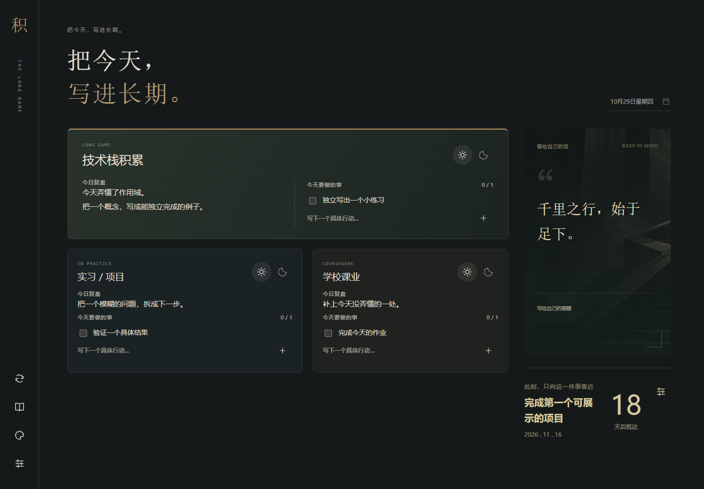
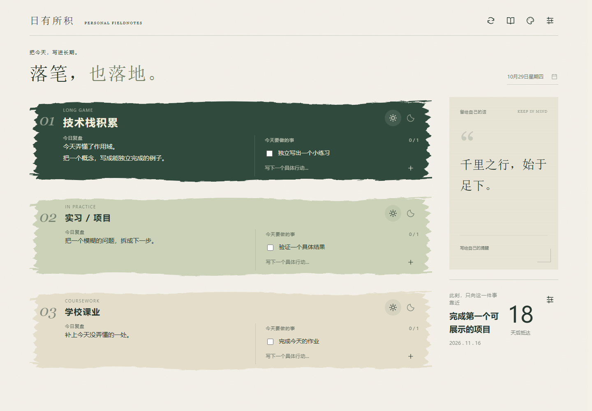
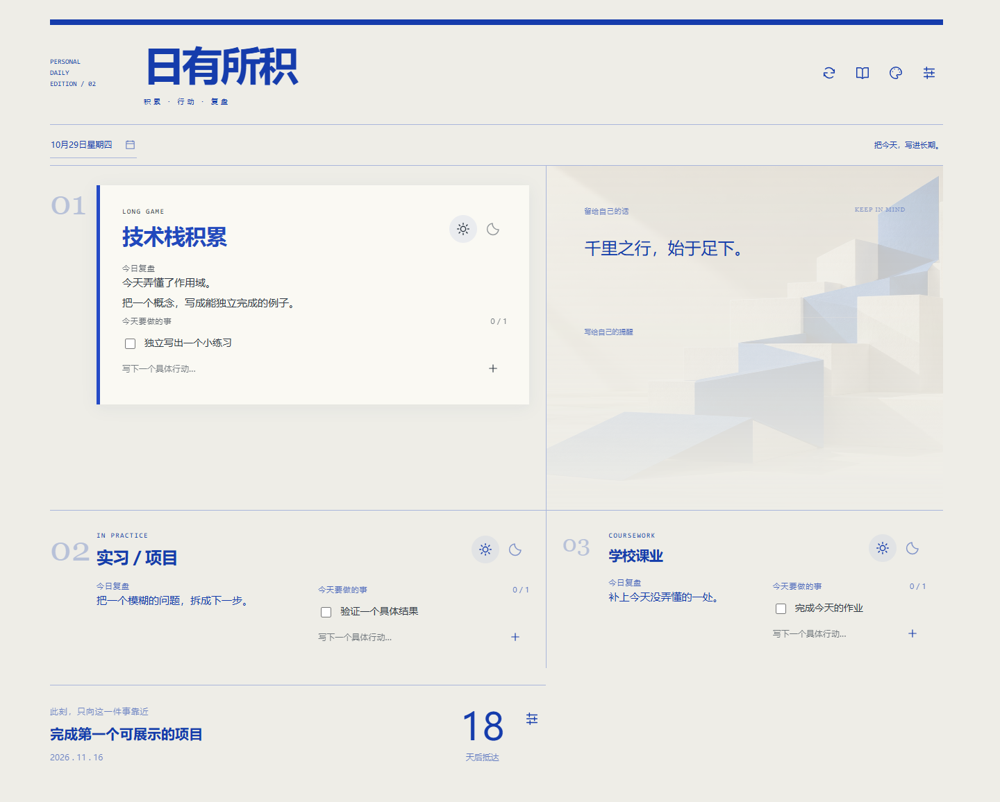
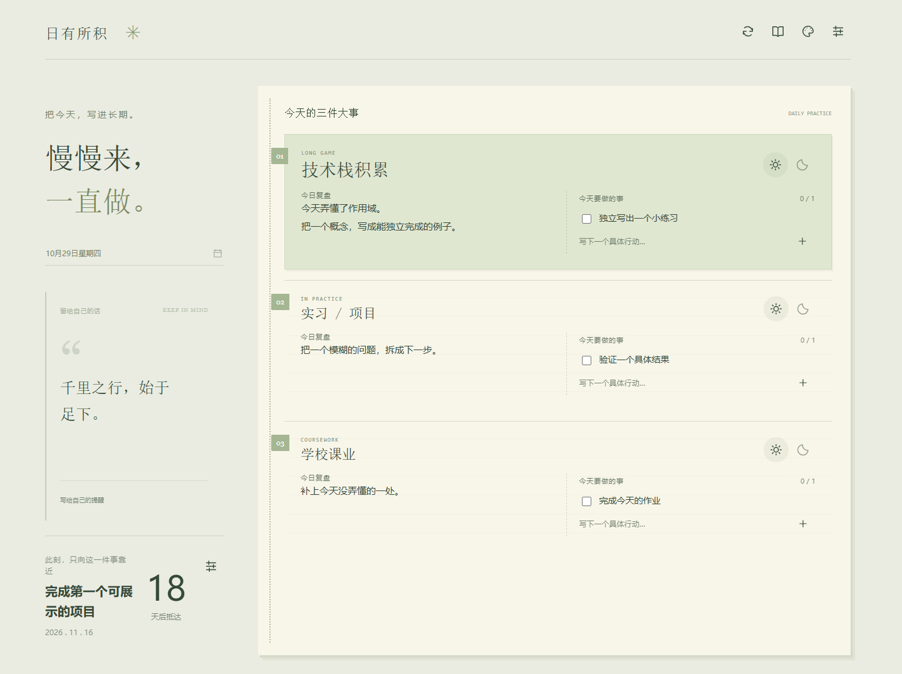
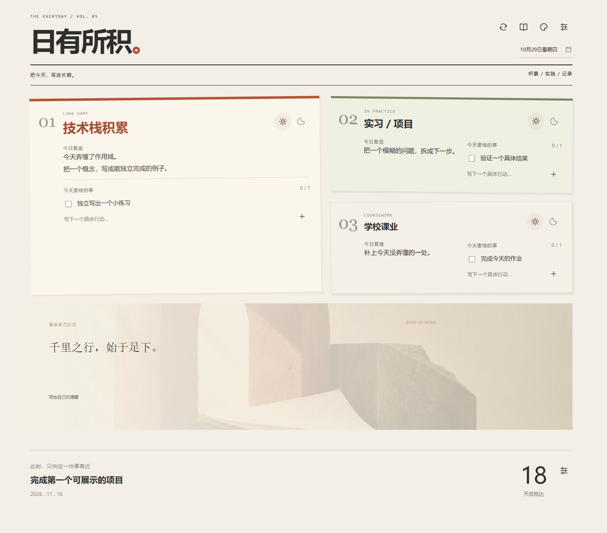

# 日有所积

**三件重要的事，一句自己的话，一个近期目标。**

一个运行在 Windows 本机的日常看板。写下今天的行动，留下复盘，为明天安排下一步；记录可以同步到 Obsidian 或其他本地 Markdown 笔记。



## 开始使用

下载 Release 中的 **日有所积-Windows便携版.zip**，完整解压，双击 **日有所积.exe**。

- Windows 10 / 11，64 位；需要 Chrome 或 Edge。
- 便携版自带 Python，无需安装开发环境或注册账号。
- 首次运行会尝试设置当前 Windows 用户的登录启动和每日提醒。若系统不允许注册任务，仍可手动使用。
- 记录保存在软件目录的 `data/`，请放在你有写入权限的位置。

## 每天如何使用

| 功能 | 用法 |
| --- | --- |
| 三个重要方向 | 默认是技术栈积累、实习／项目、学校课业；可改名 |
| 今日与明日 | 太阳图标写今日复盘和任务；月亮图标安排明天 |
| Markdown | 复盘支持实时预览，任务支持 Markdown 排版；保存原始文本 |
| 历史记录 | 用日期选择器回看或编辑；凌晨 **04:00** 换日，前一天记录不会删除 |
| 一句提醒 | 从金句文档每天抽一句，或固定展示自己的话 |
| 一个近期目标 | 设置名称和日期；显示剩余天数、今天或逾期天数 |
| 自动弹出 | 默认每天 21:00，可设置多个时间；需电脑唤醒且用户已登录 |
| 笔记同步 | 停笔约 25 秒后自动更新，也可点同步按钮立即更新 |

**时间规则：** 看板日期、金句和目标天数目前统一使用北京时间，04:00 换日；Windows 计划任务的提醒时间使用电脑的系统时区。电脑不在北京时间时，请按这两个规则设置提醒。

## 五种主题

宣纸墨痕、钴蓝印刷、深夜画室、植物手账、编辑部拼贴。设置中实时预览，保存后应用；数据共用，切换主题不会清空记录。

<details>
<summary>展开查看其他主题</summary>






</details>

## 笔记与金句

新用户无需配置：日记默认写到 `data/notes`，金句默认创建在 `data/个人金句.md`。自带金句是注明出处的公开古典名句，不包含个人日记。

设置中可分别指定 **日记根目录** 和 **金句 .md 文件**。日记支持月份分类，按年份、月份定位；第一次写到当天日记末尾，之后只更新原区域，保留你后来手写的内容。

- [笔记目录、同步保护与金句格式](docs/notes.md)
- [更新、备份与故障处理](docs/maintenance.md)

## 隐私与边界

- 服务仅监听 `127.0.0.1`。不上传记录，不接入账号、云同步或统计服务。
- 资源和 Markdown 依赖均在本地；日常使用无需请求 CDN。主动打开外部链接由浏览器访问。
- 数据不是加密存储。同一 Windows 用户有权限读取本地文件，请自行保护和备份。
- 关闭窗口不等于停止后台服务；它会继续处理已保存内容的笔记同步。
- 同一 Windows 用户目前只支持一套正式提醒任务；多份便携目录会使用同名任务，最后安装的位置生效。

## 从源码运行

需要 Python 3.10 或更新版本（发布包使用 3.13.17）。后端仅使用标准库。

```powershell
python -X utf8 server.py
```

终端会输出实际本地地址。默认从端口 47831 开始寻找可用端口；不要直接打开 HTML 文件。

```powershell
python -X utf8 -m unittest test_server.py -v
```

测试使用临时目录，不会写入你的日记。

## 构建 Windows 便携包

在 Windows PowerShell 中执行：

```powershell
powershell -NoProfile -ExecutionPolicy Bypass -File scripts/prepare-windows.ps1
.\runtime\python.exe -X utf8 build_release.py
```

准备脚本下载并校验官方 Python 嵌入版、编译启动器；打包脚本将生成便携 ZIP 和 SHA-256 校验文件。构建不启动软件，也不注册计划任务。GitHub Actions 可运行测试并生成便携包构建产物。

## 项目结构

```text
public/              五套界面、图标与本地资源
server.py            本地服务、保存、金句与同步
diary_routing.py    日记路径识别
scripts/             构建准备脚本
docs/                使用与维护说明
default-quotes.md    公开默认金句
build_release.py     干净便携包构建
launcher.cs          Windows 启动器
```

`data/`、运行环境、可执行文件、日志和个人快捷方式不进入源码仓库。

## 许可与素材

本项目采用 [MIT 许可证](LICENSE)；第三方代码与运行环境遵循其自身许可，详见 [THIRD_PARTY_NOTICES.md](THIRD_PARTY_NOTICES.md)。背景图为 AI 生成，SVG 图标为项目绘制；公开古典金句保留出处。
